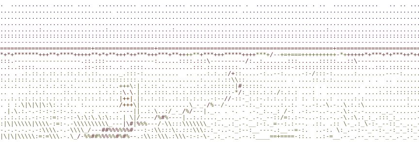

<picture>
  <source media="(prefers-color-scheme: dark)" srcset="assets/path-dark.svg" />
  
</picture>

hi, i'm joel 👋 | வணக்கம் 🙏

i work on payments and digital assets at [nium](https://www.nium.com). before that, i spent four years at [cypher](https://www.ycombinator.com/companies/cypher-wallet) (yc w22), a crypto neobank, mostly on crypto and stablecoin cards, wallets and an ai agent, with a lot of good people.

on the side:

- [franchise](https://elect.us.org) — how the world chooses who governs
- [wikijourney](https://wikijourney.xyz) — watch a word, a food or an idea travel through space and time

[site](https://jmarc.me/) · [linkedin](https://www.linkedin.com/in/joel-marc) · [x](https://x.com/JMM36912) · [email](mailto:joel.marceline3@gmail.com)
